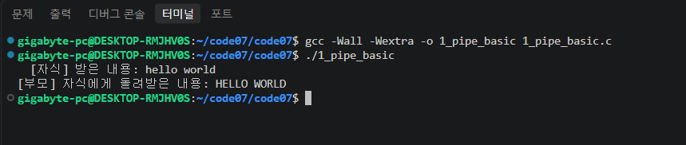
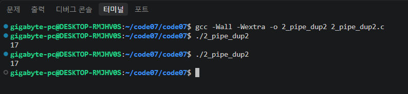
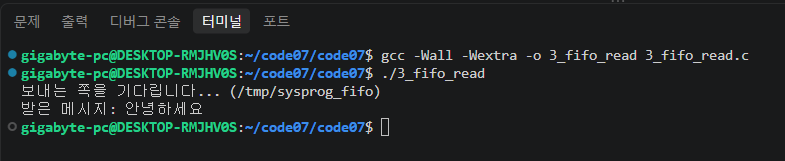
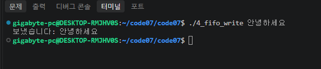

## 프로젝트 설명
1. 파이프로 왕복 프로젝트의 경우 파이프 2개를 이용하여 부모가 보낸 문자열을 자식이 대문자로 바꿔 돌려주는 통신을 한다.
2. dup2로 명령 이어 붙이기 프로젝트의 경우 콜론으로 구분된 두 명령의 표준출력과 표준입력을 각각 dup2로 바꿔치기하여 파이프라인을 구축한다.
3. FIFO로 메시지 주고받기 프로젝트의 경우 이름 있는 파이프를 활용해 독립된 프로세스 간에 메시지를 주고받고 사용 후 unlink로 정리한다.

## 실행 화면 캡처

### 1_pipe 실행 결과

### 2_dup2 실행 결과

### 3_fifo 실행 결과

AI 사용 관련 내용과 본인의 보강 내용
AI 사용 내용
1. 코드의 대부분을 Ai를 이용하여 만들었다.

보강 내용
1. 파이프, dup2, FIFO에 대한 기능은 이해는 하였지만 코드를 보며 어떻게해야 이런 식으로 작동을 하는지에 대한 공부가 필요함